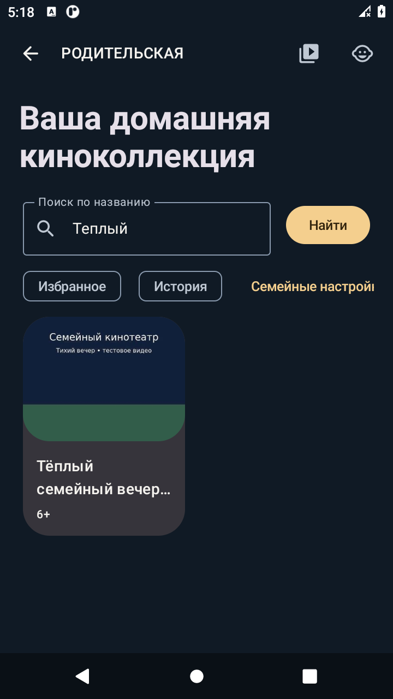
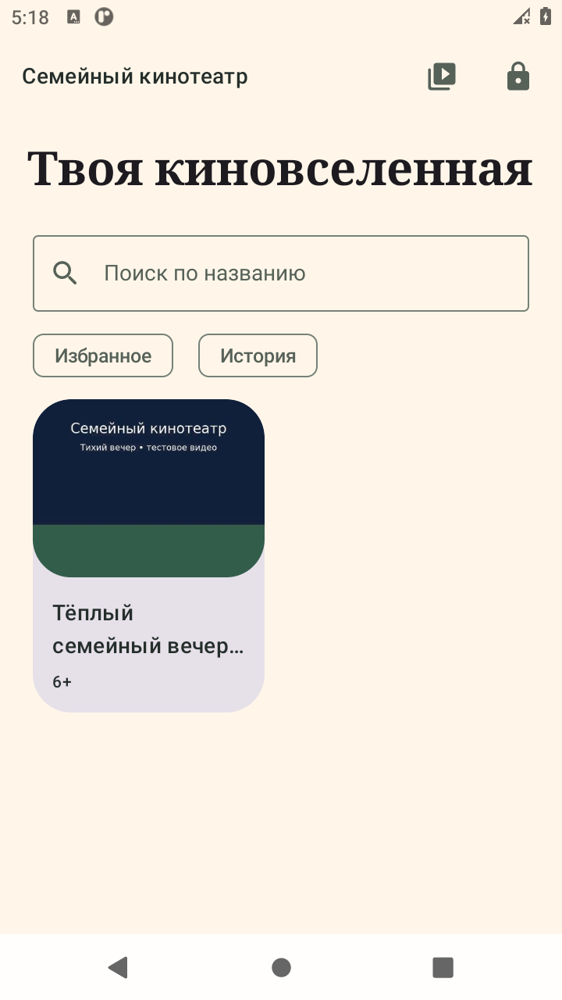
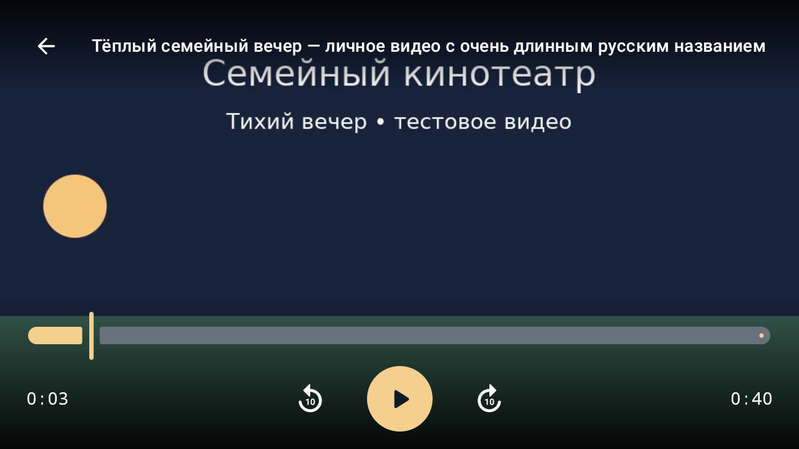
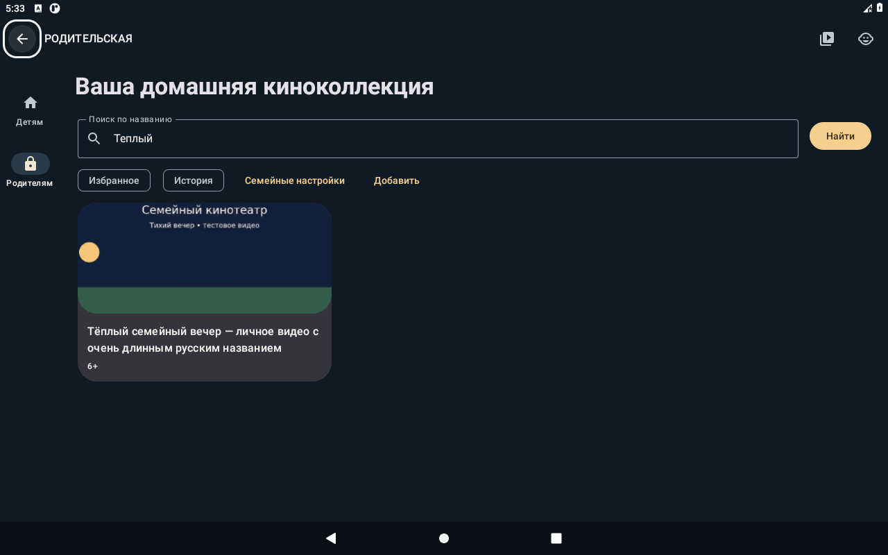
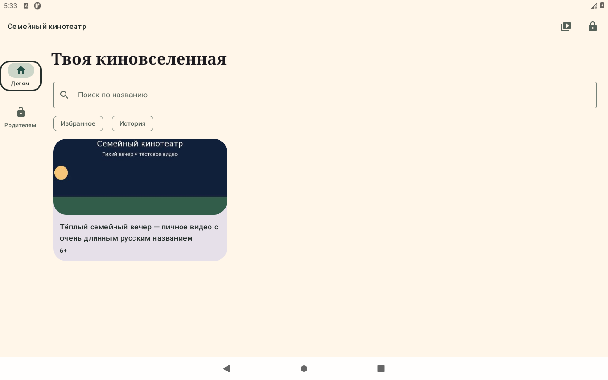
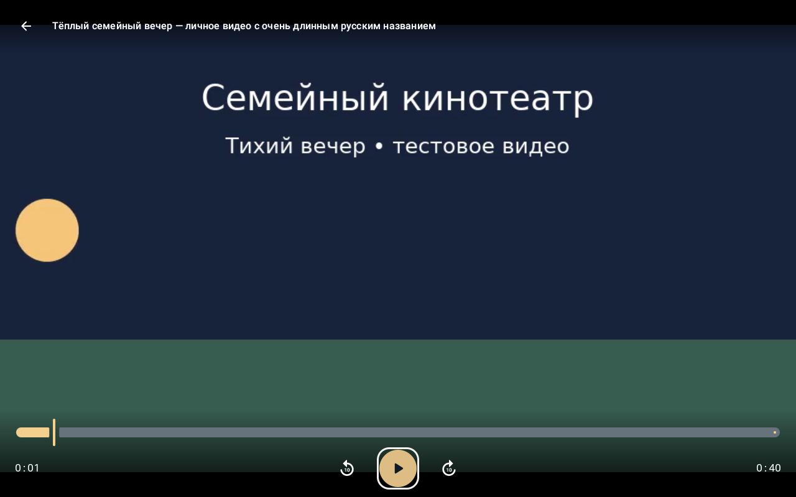
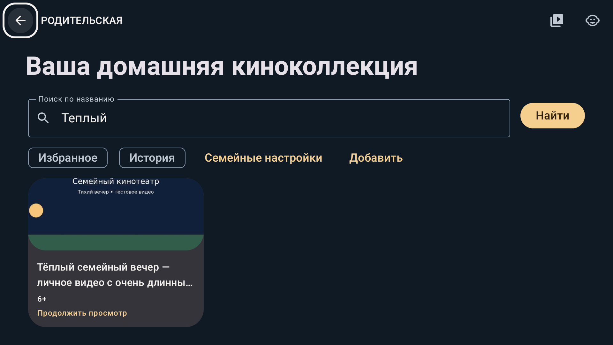
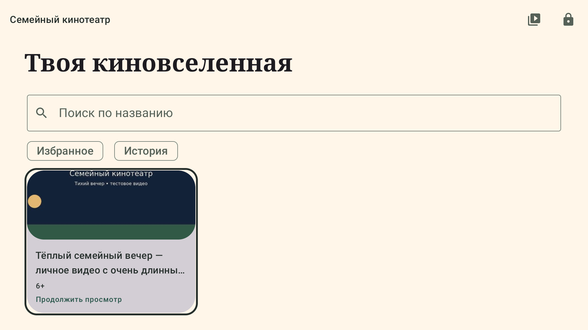
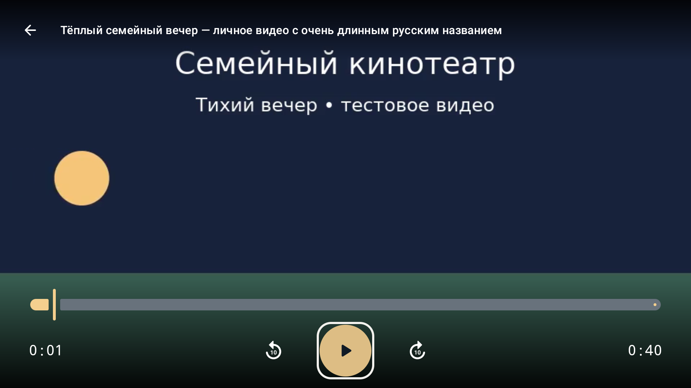

# Реальные скриншоты 0.3.0

UiAutomation screenshots приложения из Android API 30 эмуляторов; не концепт-изображения и не физические устройства. Контент — собственные CC0-клипы для испытаний, не коммерческий каталог. PNG не редактировались. Полные результаты — в [QA](../../../QA.md).

## Телефон

720×1280, 280 dpi, x86_64; плеер 1280×720.

[Журнал решений](phone-audit.png) · [Автоодобрение](phone-auto-child.png) · [Детская медиатека](phone-child.png) · [Карточка произведения](phone-details.png) · [Личная медиатека](phone-library.png) · [Родительский режим](phone-parent.png) · [Блокировка PIN](phone-pin-locked.png) · [PIN](phone-pin.png) · [Скрытие контролов](phone-player-autohide.png) · [Видео без контролов](phone-player-clean.png) · [Полноэкранный плеер](phone-player.png) · [Семейные настройки](phone-policy.png) · [Поиск](phone-search.png) · [Воспроизведение эпизода](phone-series-player.png) · [Разрешённые эпизоды](phone-series.png) · [Ошибка источника](phone-source-error.png) · [Системный ввод адреса](phone-source-input.png) · [Источники](phone-sources.png)

## Планшетная конфигурация

1280×800, 160 dpi, x86_64. Изменённая display конфигурация того же AVD, smallest width ≥600 dp; не физический планшет.

[Журнал решений](tablet-audit.png) · [Автоодобрение](tablet-auto-child.png) · [Детская медиатека](tablet-child.png) · [Карточка произведения](tablet-details.png) · [Личная медиатека](tablet-library.png) · [Родительский режим](tablet-parent.png) · [PIN](tablet-pin.png) · [Полноэкранный плеер](tablet-player.png) · [Семейные настройки](tablet-policy.png) · [Поиск](tablet-search.png) · [Воспроизведение эпизода](tablet-series-player.png) · [Разрешённые эпизоды](tablet-series.png) · [Ошибка источника](tablet-source-error.png) · [Системный ввод адреса](tablet-source-input.png) · [Источники](tablet-sources.png)

## Android TV

Отдельный android-tv/x86 system image, 1920×1080, 320 dpi, uiMode television.

[Журнал решений](tv-audit.png) · [Автоодобрение](tv-auto-child.png) · [Карточка с продолжением без обрезания](tv-card-fit.png) · [Детская медиатека](tv-child.png) · [Карточка произведения](tv-details.png) · [Личная медиатека](tv-library.png) · [Родительский режим](tv-parent.png) · [PIN](tv-pin.png) · [Полноэкранный плеер](tv-player.png) · [Семейные настройки](tv-policy.png) · [Поиск](tv-search.png) · [Воспроизведение эпизода](tv-series-player.png) · [Разрешённые эпизоды](tv-series.png) · [Ошибка источника](tv-source-error.png) · [Системный ввод адреса](tv-source-input.png) · [Источники](tv-sources.png)

